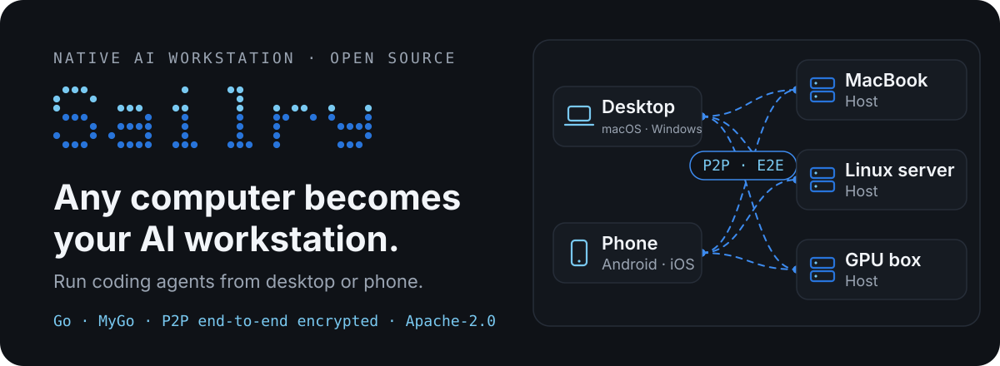
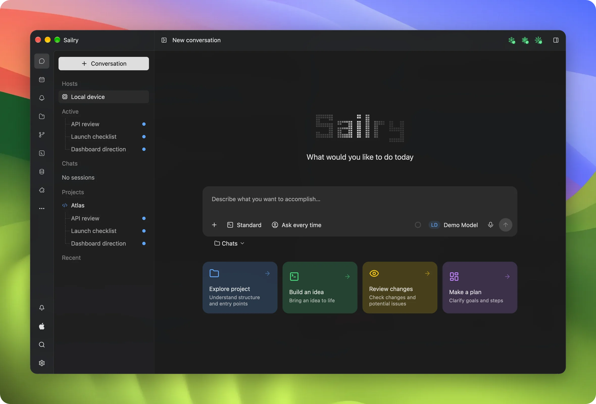

  

<h1 align="center">Sailry Code</h1>

An open-source, native AI coding workstation for your own machines.

  <a href="#install">Install</a> ·
  <a href="docs/workspace.md">Workspace guide</a> ·
  <a href="https://sailry.dev/docs/hosts/">Remote hosts</a> ·
  <a href="README.zh-CN.md">简体中文</a>

  
  

  

Run coding agents where your code lives: on your laptop, an office machine, or a remote GPU server. Choose your own models and pick up work from your phone without a Sailry cloud account. The desktop app uses native GPU rendering, without Electron.

## Install

Find Desktop and Host installers on [Sailry Code Releases](https://github.com/sailry/sailry-code/releases) as they become available.

- **Desktop:** macOS 13+ (Apple silicon or Intel) and Windows 10+ (x64).
- **Host:** macOS 13+ and Linux (glibc 2.34+). See [Install and pair a Host](https://sailry.dev/docs/hosts/#install-and-pair).
- **Mobile:** Android 7.0+ and iOS 15+. See [Mobile releases](https://github.com/sailry/sailry-code/releases?q=mobile-v&expanded=true).

[Build from source](CONTRIBUTING.md) · [Profiles, updates & privacy](docs/profiles.md)

> [!NOTE]
> Sailry Code is in early preview. Back up important work before letting an agent edit it.

## Desktop preview

  

<em>Home screen in an earlier Sailry desktop build.</em>

## How it works

- **Run next to your code.** Work in Desktop or run `sailry-host` as a background service on macOS or Linux. Accepted tasks keep running when Desktop disconnects.

- **Connect privately.** Desktop and mobile connect to Hosts over end-to-end encrypted peer-to-peer links, with [relay fallback](https://sailry.dev/docs/relays/) when a direct connection is unavailable. No port forwarding or VPN is required.

- **Continue on your phone.** Pair with a six-digit code to follow sessions, approve tool calls, inspect Git and files, or queue a message.

## Features

### Agents and workspace

Switch between Standard, Plan, and Collaborate. Agents can work in isolated Git worktrees; use the [files and Git workbench](docs/workspace.md) to search or edit files, review diffs, stage hunks, and commit changes. Integrated terminals and a bundled Python runtime are available alongside the conversation.

### Databases and SSH

Connect to PostgreSQL, MySQL, or SQLite, and work with remote terminals and SFTP. Database credentials and SSH private keys stay out of agent prompts. See the [connections guide](docs/connections.md).

### Tools and extensions

Use browser and desktop automation, read Office documents and PDFs with local OCR, and preview HTML. Agents can also search the web, generate media, and use local knowledge collections. Memory, goals, scheduled tasks, reminders, and local dictation support longer-running work.

Add [plugins](https://github.com/sailry/sailry-plugins), skills, MCP servers, or [themes](https://github.com/sailry/sailry-themes) as needed. New profiles have no preinstalled plugins or themes.

## Get started

1. [Add a model provider](https://sailry.dev/docs/models/#add-a-provider) in **Settings → Models**.
2. [Open a project](https://sailry.dev/docs/projects/): select a local folder or clone a repository.
3. Create a session, pick a model and work mode, and describe your task.
4. Optionally, [add a remote Host or pair your phone](https://sailry.dev/docs/hosts/#install-and-pair).

## Privacy

Code stores local data under `~/.sailry-code` and can migrate a stopped `~/.sailry` profile on first launch. Customize the location with `--data-dir`.

Anonymous error reports and feature counts are on by default. They do not include conversations, files, credentials, paths, or custom names. Disable either in **Settings → General → Diagnostics and privacy**, or set `SAILRY_TELEMETRY=off` or `DO_NOT_TRACK=1`. See [data directories, updates, and privacy](docs/profiles.md).

## Built on Sailry Harness & Contributing

[Sailry Harness](https://github.com/sailry/sailry-harness) provides the agent runtime, model layer, P2P networking, UI framework, and SDK. Sailry Code assembles the developer workbench and ships the product.

[Build and contribute](CONTRIBUTING.md) · [Architecture](ARCHITECTURE.md) · [Engineering rules](AGENTS.md)

## Community & License

[Discord](https://discord.gg/MCDktmDey) · [GitHub Issues](https://github.com/sailry/sailry-code/issues)

Licensed under [Apache-2.0](LICENSE). Third-party materials retain their licenses; see [NOTICE](NOTICE).
