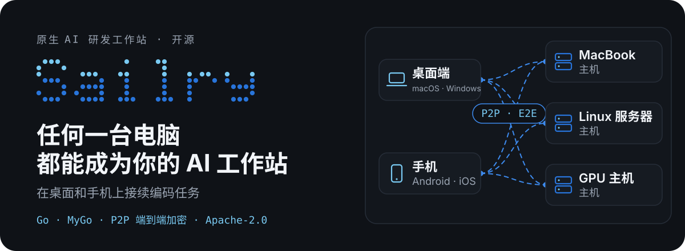
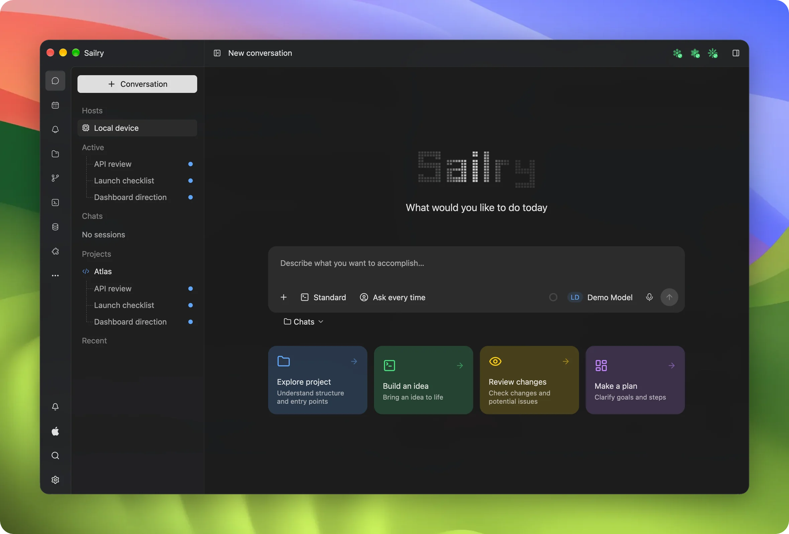

  

<h1 align="center">Sailry Code</h1>

在自己的机器上运行智能体的开源原生 AI 研发工作站。

  <a href="#安装">安装</a> ·
  <a href="docs/workspace.md">工作区指南</a> ·
  <a href="https://sailry.dev/zh/docs/hosts/">远程主机</a> ·
  <a href="README.md">English</a>

  
  

  

让编码智能体在代码所在的机器上工作，无论是笔记本、办公主机还是远程 GPU 服务器。模型由你选择，手机也能接续任务，无需 Sailry 云账号。桌面端采用原生 GPU 渲染，不依赖 Electron。

## 安装

桌面端与 Host 安装包发布后，可在 [Sailry Code Releases](https://github.com/sailry/sailry-code/releases) 下载。

- **桌面端：** macOS 13+（Apple 芯片或 Intel）、Windows 10+（x64）。
- **Host：** macOS 13+、Linux（glibc 2.34+）。见[安装与配对指南](https://sailry.dev/zh/docs/hosts/#install-and-pair)。
- **移动端：** Android 7.0+（[从发布页下载 `Sailry-android-arm64.apk`](https://github.com/sailry/sailry-code/releases)）、iOS 15+（TestFlight）。

[从源码构建](CONTRIBUTING.md) · [数据目录、更新与隐私](docs/profiles.md)

> [!NOTE]
> Sailry Code 仍处于早期预览阶段。让智能体修改重要文件前，请先备份。

## 桌面预览

  

<em>早期 Sailry 桌面版的首页。</em>

## 工作方式

- **在代码所在的机器上执行。** 可以直接用桌面端，也可以在 macOS 或 Linux 上运行后台 `sailry-host` 服务。桌面断开后，已经接收的任务会继续执行。

- **安全连接各台主机。** 桌面端与手机使用端到端加密的点对点链路。直连不可用时自动走[中继](https://sailry.dev/zh/docs/relays/)，无需端口转发或 VPN。

- **用手机接续任务。** 通过六位配对码连接后，可以跟进会话、审批工具操作、查看 Git 与文件，或排队发送后续指令。

## 核心特性

### 智能体与工作区

在标准、计划和协作模式间切换。可让智能体在独立的 Git worktree 中工作，用[文件与 Git 工作台](docs/workspace.md)检索和编辑文件、查看差异、按块暂存并提交改动。会话旁还提供集成终端与内置 Python 环境。

### 数据库与 SSH

连接 PostgreSQL、MySQL 或 SQLite，使用远程终端或 SFTP。数据库凭据和 SSH 私钥不会进入模型提示。详见[连接指南](docs/connections.md)。

### 工具与扩展

支持浏览器和桌面自动化、Office 与 PDF 读取、本地 OCR 和 HTML 预览。智能体还可使用网络搜索、媒体生成和本地知识库，并通过记忆、目标、定时任务、提醒与本地听写接续工作。

可按需接入[插件](https://github.com/sailry/sailry-plugins)、技能、MCP 服务或[主题](https://github.com/sailry/sailry-themes)。新配置不预装插件和主题。

## 开始使用

1. 在**设置 › 模型**中[添加模型服务商](https://sailry.dev/zh/docs/models/#add-a-provider)。
2. [打开项目](https://sailry.dev/zh/docs/projects/)：选择本地文件夹或克隆仓库。
3. 创建会话，选定模型和工作模式，描述你的任务。
4. 按需[添加远程 Host 或配对手机](https://sailry.dev/zh/docs/hosts/#install-and-pair)。

## 隐私

Code 默认使用 `~/.sailry-code` 存储本地数据。首次启动时可以迁移已停止的 `~/.sailry` 配置，也可用 `--data-dir` 指定其他目录。

默认开启匿名错误报告和功能计数，不包含会话、文件、凭据、路径或自定义名称。可在**设置 › 通用 › 诊断与隐私**中关闭，也可设置 `SAILRY_TELEMETRY=off` 或 `DO_NOT_TRACK=1`。详见[数据目录、更新与隐私](docs/profiles.md)。

## 基于 Sailry Harness 与参与贡献

[Sailry Harness](https://github.com/sailry/sailry-harness) 提供智能体运行时、模型层、P2P 网络、UI 框架与 SDK；Sailry Code 在其上装配研发工作台并发布产品。

[构建与贡献](CONTRIBUTING.md) · [架构文档](ARCHITECTURE.md) · [工程规范](AGENTS.md)

## 社区与许可证

[Discord](https://discord.gg/MCDktmDey) · [GitHub Issues](https://github.com/sailry/sailry-code/issues)

本项目基于 [Apache-2.0](LICENSE) 开源。第三方材料保留原有许可，见 [NOTICE](NOTICE)。
